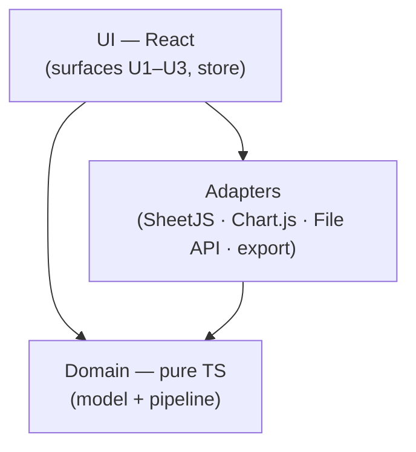
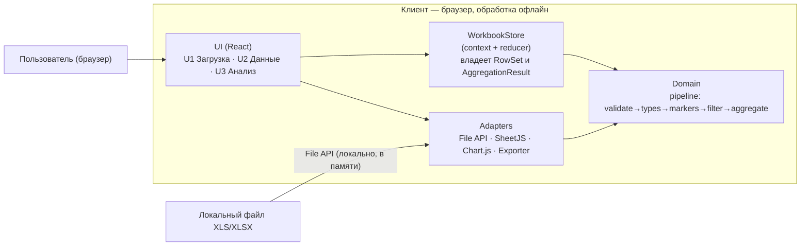
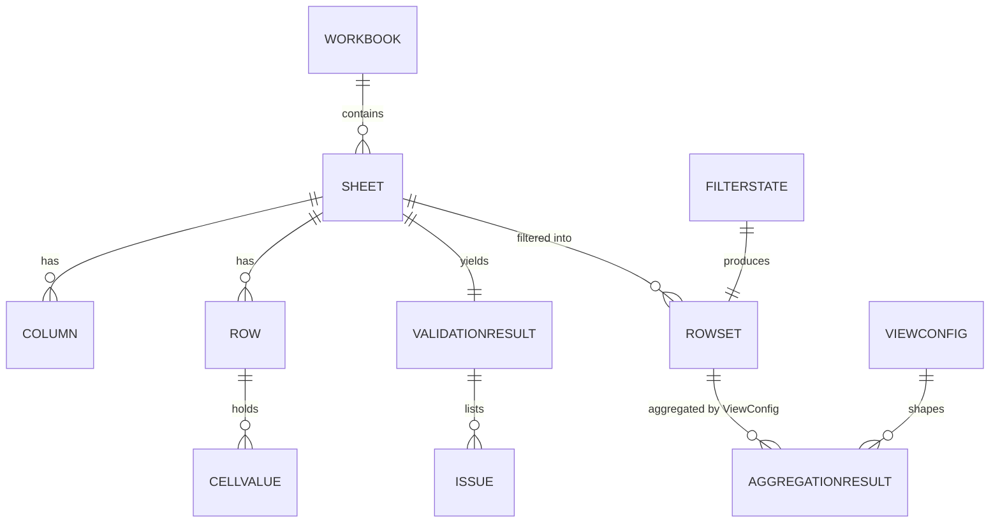

# Architecture Spine — XLS-Analytics

## Design Paradigm

**Layered, client-only app with a pipes-and-filters data pipeline.** Three layers, one dependency direction:

- **UI** (`src/ui/`) — React components + hooks for the three surfaces (U1 Загрузка, U2 Данные, U3 Анализ) and the session store. Holds no parsing/aggregation logic; calls domain functions and adapters.
- **Domain** (`src/domain/`) — pure TypeScript. The pipeline is a chain of pure functions: `validateStructure → inferTypes → detectSectionMarkers → applyFilter → aggregate`, over the canonical model. Zero imports from React, SheetJS, Chart.js, or the DOM. Owns every data rule.
- **Adapters** (`src/adapters/`) — thin side-effect edges, each behind a narrow interface: `fileSource` (File API), `spreadsheet` (SheetJS read/write), `charts` (Chart.js), `exporter` (PNG/PDF/XLSX). No business rules.



The domain has **no outgoing edges**, and there is no `adapters → UI` edge (AD-2) — the two most load-bearing shapes here.

## Invariants & Rules

### AD-1 — Client-only; no network egress of file content [ADOPTED]

- **Binds:** all (CAP-1…CAP-7)
- **Prevents:** a builder adding an upload/analytics endpoint that ships the workbook off-device, contradicting the privacy promise in the spec/UX.
- **Rule:** No code path transmits workbook or cell contents over the network. Parse, type, filter, aggregate, and export all run in-browser. Network use is limited to loading the app's own static assets.

### AD-2 — Layer direction; the domain is pure; adapters never reach the UI [ADOPTED]

- **Binds:** all
- **Prevents:** parsing/aggregation logic leaking into components or adapters; two builders implementing the pipeline twice, divergently; an adapter importing the store and mutating UI state.
- **Rule:** `src/domain` MUST NOT import React, SheetJS/`xlsx`, Chart.js, or touch the DOM/File API. `src/adapters` MUST NOT import UI or the store — the `adapters → UI` edge does not exist; adapters depend on domain types only. UI depends on domain and adapters. Every data rule lives in the domain as a pure function.

### AD-3 — One session store; in-memory only; immutable updates [ADOPTED]

- **Binds:** CAP-1…CAP-7 (UI)
- **Prevents:** competing sources of truth (component-local workbook copies), accidental persistence, and in-place mutation that breaks React change detection / creates stale closures.
- **Rule:** A single `WorkbookStore` (React context + reducer) holds the session: current `Workbook`, active sheet, `ValidationResult`, `FilterState`, `ViewConfig`, `RowSet`, `AggregationResult`. Reducers replace state **immutably** (new `Workbook`/`Sheet`/`RowSet` references); no in-place mutation. Workbook data is never persisted (no localStorage/IndexedDB); UI preferences (e.g. theme) may persist.

### AD-4 — Canonical in-memory data model [ADOPTED]

- **Binds:** CAP-2…CAP-7
- **Prevents:** each surface inventing its own row/column/type shape; incompatible aggregation inputs; "extension" that is really a divergent shape.
- **Rule:** Data flows only as the canonical types, with at least these named fields (new fields may be added; **no renaming or shadowing**):
  - `Workbook{ fileName, sheets: Sheet[], activeSheetName }`
  - `Sheet{ name, columns: Column[], rows: Row[], headerRowIndex }`
  - `Column{ index, header, normalizedHeader, type: 'number'|'date'|'text', required, nonEmptyCount, emptyCount }`
  - `Row{ index, cells: CellValue[], isSectionMarker }`, `CellValue = number | Date | string | null`
  - `ValidationResult{ status: 'ok'|'warnings'|'blocked', issues: Issue[] }`
  - `Issue{ severity: 'blocking'|'warning', code, message, column? }`
  - `FilterState{ categories: Record<string, string[]>, dateRange?: { from, to } }`
  - `ViewConfig{ chartType: 'line'|'bar'|'pie'|'table', dimension, measure }`
  - `AggregationResult{ groupBy, measure, buckets: { key, sum, count }[], total }`

### AD-5 — One issue shape; warnings are never silently repaired [ADOPTED]

- **Binds:** CAP-2, CAP-3, all error surfaces
- **Prevents:** blocking errors and warnings diverging in shape; silent "fixing" of dirty XLS constructs.
- **Rule:** Every validation or runtime problem is an `Issue{ severity: 'blocking'|'warning', code, message, column? }`. `blocking` halts analysis for the file/sheet; `warning` continues but is surfaced. The app never mutates source data to hide an issue.

### AD-6 — Schema & header matching are one domain constant [ADOPTED]

- **Binds:** CAP-2, CAP-4, CAP-5
- **Prevents:** two builders matching headers differently (case / `ё` / whitespace) and disagreeing on "required column missing".
- **Rule:** `REQUIRED_COLUMNS` (B–G: Тип задачи, Задача, Статус, Исполнитель, Тип работы, Затрачено времени (ч)) is a single domain constant. Header matching normalizes: trim, Unicode case-fold, `ё`→`е`, collapse internal whitespace. A **section-marker row** is defined as: only the `Эпик` column non-empty → `isSectionMarker`.

### AD-7 — Row limit enforced from metadata, before materialization [ADOPTED]

- **Binds:** CAP-1
- **Prevents:** off-by-one / per-sheet-vs-per-file inconsistency and OOM on oversized files.
- **Rule:** The parse adapter reads every worksheet's row count from workbook metadata and **checks it before any `Row` object is materialized** (OOM guard). The limit is **30 000 raw data rows summed across all sheets of the file** (worksheet rows minus header/marker rows) — per-file, not per-sheet. Crossing it raises `Issue{ code: ROW_LIMIT_EXCEEDED }` (blocking, per AD-18) naming the count and the limit, and the file is refused.

### AD-8 — Filter & aggregation semantics are shared and pure [ADOPTED]

- **Binds:** CAP-5, CAP-6
- **Prevents:** charts and pivot computing from different subsets; filters applied inconsistently across views.
- **Rule:** `applyFilter(sheet, filterState) → RowSet` is applied once; every view (line/bar/pie/pivot/export) consumes that same `RowSet`. Category filters are conjunctive across categories, disjunctive within one. The date filter exists only when at least one `Column.type === 'date'`. `AggregationResult` derives from `RowSet` only.

### AD-9 — Date & number normalization [ADOPTED]

- **Binds:** CAP-4, CAP-5, CAP-6, CAP-7
- **Prevents:** mixed string/Date/number cells breaking filters and sums; display/export locale drift.
- **Rule:** At parse, date cells become `Date` (SheetJS `cellDates`), numeric cells become `number`, everything else `string`. Aggregation sums raw numbers (no pre-rounding). Display via `Intl` `ru-RU`; exports serialize dates as ISO 8601 and numbers unformatted.

### AD-10 — Export is a pure derivation of current view state [ADOPTED]

- **Binds:** CAP-7
- **Prevents:** exports diverging from the screen (filters ignored) or being generated from a second pipeline.
- **Rule:** PNG reproduces the active chart canvas; XLSX writes the current `RowSet`/`AggregationResult`; PDF renders the current chart + summary. Every exporter consumes the same `(RowSet, ViewConfig)` pair the screen uses.

### AD-11 — Static-only build artifact [ADOPTED]

- **Binds:** all (operational envelope)
- **Prevents:** a builder introducing a runtime server (API routes/hosted backend) that breaks the client-only promise and the deployment story.
- **Rule:** The build output is static assets (`dist/`) runnable from any static host or local file server. No server runtime, no backend API, no build-time secret.

### AD-12 — Derived state has a single owner [ADOPTED]

- **Binds:** CAP-3…CAP-7 (UI + domain)
- **Prevents:** the store and a component both deriving `RowSet`/`AggregationResult` (both would obey AD-3+AD-8 yet disagree).
- **Rule:** The store computes `RowSet` and `AggregationResult` from `(sheet, filterState, viewConfig)` — exactly once. Components and adapters only **read** them; no component calls `applyFilter`/`aggregate` or caches its own copy.

### AD-13 — `ViewConfig` is the one view descriptor [ADOPTED]

- **Binds:** CAP-6, CAP-7
- **Prevents:** a singular `AggregationResult` unable to serve four views, so a PDF/XLSX export serializes a different aggregation than the screen.
- **Rule:** `ViewConfig{ chartType: 'line'|'bar'|'pie'|'table', dimension, measure }` is canonical. Chart, pivot table, and every exporter consume the same `(RowSet, ViewConfig)` pair; changing a view changes `ViewConfig` in the store and nothing else.

### AD-14 — The pipeline emits one marker-free `RowSet` [ADOPTED]

- **Binds:** CAP-3…CAP-7
- **Prevents:** section-marker exclusion applied in some consumers but not others; `RowSet` purity left undefined.
- **Rule:** Section-marker rows are excluded at exactly one pipeline point (end of `detectSectionMarkers`). Every `RowSet` is **marker-free by construction**; no downstream consumer re-filters markers.

### AD-15 — Type inference & blank policy [ADOPTED]

- **Binds:** CAP-4, CAP-5, CAP-6
- **Prevents:** divergent column typing and blank handling, producing different sums/pivots per builder.
- **Rule:** A column's type is the **majority non-empty type** across its cells (`number`|`date`|`text`); a column is `date` only if its non-empty values are date-parseable, otherwise `text`. Blank cells become `null`. Aggregation sums only non-`null` numerics; blanks are counted (`emptyCount`) and surfaced, **never silently coerced to 0**.

### AD-16 — Dirty XLS constructs are warned, never repaired [ADOPTED]

- **Binds:** CAP-2
- **Prevents:** silently "cleaning" merged cells / hidden sheets / extra header rows, violating the warn-only policy.
- **Rule:** Merged cells, hidden sheets, and extra header rows are detected and raised as `Issue{ severity: 'warning' }`; the source data is never mutated to normalize them. Only section-marker rows are excluded from analytics (AD-14) — and that exclusion is itself surfaced (AD-5).

### AD-17 — Atomic load [ADOPTED]

- **Binds:** CAP-1, CAP-2
- **Prevents:** partial state after a failed parse/validation; two builders leaving different half-loaded states.
- **Rule:** The store transitions only on a fully successful parse+validate. A failure leaves the prior state intact (or the empty state) — never a partially populated `Workbook`.

### AD-18 — One issue-severity matrix [ADOPTED]

- **Binds:** CAP-2, CAP-3
- **Prevents:** the same condition classified blocking in one path and a warning in another.
- **Rule:** A single table maps `Issue.code` → severity. **Blocking:** `UNSUPPORTED_FORMAT`, `CORRUPT_FILE`, `ROW_LIMIT_EXCEEDED`, `MISSING_REQUIRED_COLUMN`. **Warning:** `SECTION_ROWS_EXCLUDED`, `MERGED_CELLS`, `HIDDEN_SHEETS`, `EXTRA_HEADER_ROWS`, `UNKNOWN_COLUMN_TYPE`. Adding a code means adding a row.

### AD-19 — One chart instance, one owner [ADOPTED]

- **Binds:** CAP-6, CAP-7
- **Prevents:** StrictMode double-invoke leaking Chart.js instances, or a blank PNG export because the exporter reads a destroyed canvas.
- **Rule:** Exactly one canvas and one Chart.js instance per chart view, owned by the store effect (created once, updated on data change, destroyed on unmount); effects are idempotent. The PNG/PDF exporter reads the current live instance — it never creates its own canvas.

### AD-20 — Operating envelope [ADOPTED]

- **Binds:** all (operational)
- **Prevents:** silent telemetry, an unbounded bundle, and an unmeasured load path that violates the success metric.
- **Rule:** No telemetry, analytics, or error reporting leaves the device (AD-1). Time from load to first chart stays within the SM-1 budget (**< 1 min**) for a 30 000-row file; heavy adapters (SheetJS full, jsPDF) load lazily on first use. The app ships one static `dist/` (AD-11); the version string comes from a build-time constant.

## Consistency Conventions

| Concern | Convention |
| --- | --- |
| Naming (entities, files, interfaces, events) | Files kebab-case (`workbook-store.ts`); React components PascalCase (`DropZone.tsx`); domain functions camelCase verbs (`inferTypes`, `applyFilter`); types PascalCase; `Issue.code` SCREAMING_SNAKE (`MISSING_REQUIRED_COLUMN`, `ROW_LIMIT_EXCEEDED`, `SECTION_ROWS_EXCLUDED`, `UNSUPPORTED_FORMAT`, `CORRUPT_FILE`, … per AD-18). |
| Data & formats (ids, dates, error shapes, envelopes) | Cell value = `number | Date | string | null`. Dates: `Date` in memory, ISO 8601 at boundaries, `Intl ru-RU` for display. Numbers unformatted in exports. Column identity = index + normalized header name; sheets keyed by name. One `Issue` shape for all problems (AD-5). |
| State & cross-cutting (mutation, errors, logging, config, auth) | Single store mutated via reducer actions (`LOAD_FILE`, `SET_SHEET`, `SET_FILTER`, `SET_VIEW`, `RESET`); updates immutable (AD-3). No workbook persistence; theme preference may persist in localStorage. All user-facing strings live in one `ru` message catalog — no hardcoded strings in components. Errors surface as `Issue` and map to UI text by `code`. No auth, no logging of cell contents. |
| Testing | Domain pipeline unit-tested with Vitest in isolation (no DOM, no canvas). Component tests in jsdom. Chart/canvas behavior tested only in Vitest **browser mode** — jsdom does not implement `<canvas>`. |

## Stack

<!-- SEED — versions verified on the web at authoring (2026-10-13, live npm registry + vendor docs), then reconciled against the toolchain's own engines. The code owns this once it exists. -->

| Name | Version | Note |
| --- | --- | --- |
| Node (tooling runtime) | `^22.22.2 \|\| ^24.15.0 \|\| >=26.0.0` | effective floor from Vitest 5.0.4 + jsdom 30.1.2 + ESLint 10.12.0 engines; Node 20 is EOL. `[ASSUMPTION]` |
| TypeScript | 6.0.x | not 7.0.2: `typescript-eslint@8.71.2` declares peer `typescript <6.1.0`; typed linting beats the 10× native-compiler speedup. `[ASSUMPTION]` |
| Vite | 8.3.4 | build + dev server; `create-vite@9.2.1`, template `react-ts` is current |
| React / react-dom | 19.3.0 | + `@types/react` / `@types/react-dom` 19.3.0 |
| @vitejs/plugin-react | 6.1.2 | SWC variant `@vitejs/plugin-react-swc` 4.3.3 is an option |
| SheetJS (`xlsx`) | 0.20.3 | install the CDN tarball `https://cdn.sheetjs.com/xlsx-0.20.3/xlsx-0.20.3.tgz` (imports as `xlsx`); use the **full** build — `mini` drops `.xls`; npm `xlsx@0.18.5` is banned (frozen since 2022; ReDoS CVE-2024-22363); vendor the `.tgz` |
| Chart.js | 4.5.1 | ESM-first (ships ESM + CJS + UMD); tree-shakeable (`chart.js/auto` vs manual registration) |
| jsPDF | 4.2.1 | PDF export via `canvas.toDataURL()`; `jspdf-autotable` optional for tables |
| Vitest | 5.0.4 | + `jsdom` 30.1.2 (canvas unimplemented → chart tests via browser mode, provider `@vitest/browser-playwright` 5.0.4); coverage `@vitest/coverage-v8` 5.0.4 |
| ESLint | 10.12.0 | flat config only; `@eslint/js` 10.0.1, `typescript-eslint` 8.71.2, `eslint-plugin-react-hooks` 7.1.1, `eslint-plugin-react-refresh` 0.5.7 |
| Prettier | 3.9.10 | + `eslint-config-prettier` |

## Structural Seed

**Container view (C4-lite).**



**Core-entity ERD (relationships only).**



**Source tree.**

```text
{root}/
  src/
    ui/                 # React: surfaces + store (AD-2, AD-3, AD-12)
      screens/          # UploadScreen, DataScreen, AnalysisScreen
      components/       # DropZone, SheetTabs, TypeChip, FilterBar, ChartCard, PivotTable, WarningBanner
      store/            # workbook-store.ts (context + reducer) — owns RowSet/AggregationResult
      i18n/             # ru message catalog
    domain/             # pure TS, no framework/lib imports (AD-2)
      model.ts          # canonical types (AD-4)
      schema.ts         # REQUIRED_COLUMNS + header normalization (AD-6)
      pipeline/         # validateStructure, inferTypes, detectSectionMarkers, applyFilter, aggregate
      issues.ts         # Issue shape + codes + severity matrix (AD-5, AD-18)
    adapters/
      file-source.ts    # File API -> bytes; row-limit guard (AD-7)
      spreadsheet.ts    # SheetJS read (.xls/.xlsx) + write (.xlsx); lazy-loaded (AD-9, AD-20)
      charts.ts         # Chart.js instance lifecycle (line/bar/pie) (AD-19)
      exporter/         # png.ts · pdf.ts · xlsx.ts (AD-10, AD-19)
    app/                # bootstrap, surface routing, theme
  tests/                # vitest: domain unit + component tests
  public/
  index.html
  vite.config.ts
  tsconfig.json
```

**Deployment & environments.**


## Capability → Architecture Map

| Capability / Area | Lives in | Governed by |
| --- | --- | --- |
| CAP-1 Загрузка XLS/XLSX | `adapters/file-source.ts`, `adapters/spreadsheet.ts`, `ui/screens/UploadScreen` | AD-1, AD-7, AD-11, AD-17, AD-20 |
| CAP-2 Валидация структуры | `domain/pipeline/validateStructure`, `domain/schema.ts`, `domain/issues.ts` | AD-5, AD-6, AD-16, AD-18 |
| CAP-3 Предпросмотр и выбор листа | `ui/screens/DataScreen`, `ui/store` | AD-3, AD-4, AD-12 |
| CAP-4 Автоопределение типов | `domain/pipeline/inferTypes` | AD-4, AD-6, AD-9, AD-15 |
| CAP-5 Фильтры | `domain/pipeline/applyFilter`, `ui/components/FilterBar` | AD-8, AD-9, AD-12, AD-14 |
| CAP-6 Визуализация (графики + сводная) | `ui/components/ChartCard`, `PivotTable`, `adapters/charts.ts` | AD-8, AD-12, AD-13, AD-19 |
| CAP-7 Экспорт PNG/PDF/XLSX | `adapters/exporter/*` | AD-10, AD-13, AD-19 |
| Operational envelope | static `dist/` build; tooling chain | AD-1, AD-11, AD-20 |

## Deferred

- **Web Worker parsing** — v1 parses on the main thread; revisit if parse exceeds ~1 s or the UI janks at the 30 000-row limit.
- **PWA / offline install** — a static build already runs offline once loaded; revisit only if installability is wanted.
- **i18n beyond Russian** — one `ru` catalog for v1; revisit on a second-language demand.
- **Session persistence / upload history** — out of scope by the PRD; AD-3 blocks it. Revisit only if product scope changes.
- **Column-mapping UI for non-standard headers** — the single-sample schema (B–G) covers v1; revisit when a differently-shaped export appears (already an open blocker in the spec).
- **Theme token implementation** — owned by `DESIGN.md`; the spine fixes only that theme preference may persist (localStorage). CSS token values are seed.
- **CI / release pipeline & versioning** — no CI for v1; build is local (`vite build`) with a build-time version constant (AD-20). Revisit if distribution grows.
- **Error reporting sink** — none; local console only (AD-1, AD-20). Revisit only if a server appears (out of scope).
- **Vitest browser provider** — Playwright vs Webdriver decided when the first chart test lands.
